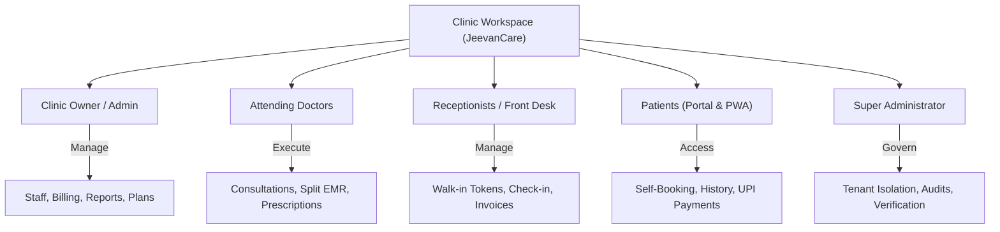
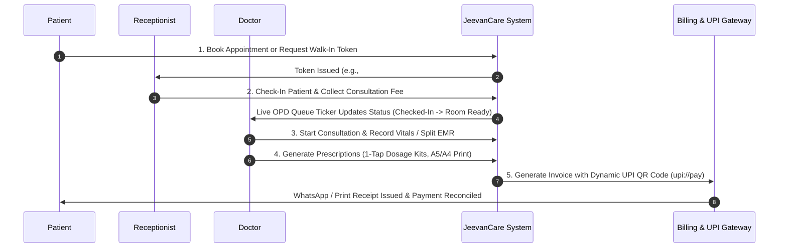

# JeevanCare Platform — Complete System Architecture & Operational Workflow Documentation

> **Platform Name:** JeevanCare — Your Trusted Healthcare Companion
> **Brand Identity:** Simple, connected healthcare for patients, doctors, and clinics.
> **Designed & Developed by:** Subramanian T S, WebCraft Digital Solutions.

---

## 1. Executive Summary & Platform Overview

JeevanCare is a modern, multi-tenant healthcare SaaS application specifically built for Indian clinics, nursing homes, and outpatient departments (OPD). The platform connects five core user roles—**Clinic Owners**, **Doctors**, **Receptionists / Front-Desk Staff**, **Patients**, and **Super Administrators**—into a single, highly synchronized workspace.

---

## 2. Authentication, Quick Login & Clinic Registration

JeevanCare provides a 1-click Quick Login toolbar for instant role switching during demonstration and daily operations, along with a self-serve clinic onboarding wizard.

---

## 3. End-to-End Complete Care Workflow (5-Stage Engine)

### Stage 1: Public Doctor Finder & Appointment Booking
- **Public Directory (`/clinics`):** Patients search doctors by specialty, city, and available time slots.

### Stage 2: Primary Dashboard & OPD Live Queue Management
- **Dashboard Overview (`/dashboard`):** Real-time OPD Queue Stepper (`Checked-In` ➔ `In Lobby` ➔ `In Consult` ➔ `Completed`), Live Doctor Schedule Pace Banner, and primary KPI metrics.

### Stage 3: Multi-Doctor Day Rail Schedule & Appointment Booking
- **Day Rail Schedule (`/dashboard/appointments`):** Multi-doctor timeline tracking check-ins, consultation statuses, and walk-in token queues.
- **New Appointment Form (`/dashboard/appointments/new`):** Front-desk appointment slot booking and walk-in token generation.

### Stage 4: Patient Roster, Registration & EMR Consultations
- **Patient Roster (`/dashboard/patients`):** Searchable patient database with MRN lookup, phone search, and slide-over drawers.
- **Register Patient (`/dashboard/patients/new`):** Quick 1-click patient registration with phone number validation.
- **New Visit & EMR (`/dashboard/visits/new`):** Vitals recording, speech-to-text dictation, 1-tap prescription treatment kits, and medicine directory search.

### Stage 5: Invoices, Dynamic UPI QR Payments & Lobby TV Display
- **Invoices & Billing (`/dashboard/invoices`):** Total collected revenue (₹ INR), pending balance due, and itemized invoice generation with dynamic `upi://pay` payment QR codes.
- **Waiting Room TV (`/dashboard/queue-display`):** High-contrast lobby TV queue display with patient token callout chimes.

---

## 4. Clinic Administration, Reports & Staff Management

- **Monthly Reports (`/dashboard/reports`):** Owner financial reports breaking down monthly revenue collections, completion rates, and per-doctor splits.
- **Staff Management (`/dashboard/staff`):** Configures doctor specialties, timings, and staff accounts.
- **Workspace Settings (`/dashboard/settings`):** Configures clinic details, timezone (Asia/Kolkata), currency (₹ INR), and subscription plan.

---

## 5. Patient Portal & Super Admin Workflows

- **Patient Portal (`/patient/dashboard`):** Self-service dashboard for patients to view past prescriptions, medical documents, and billing history.
- **Patient Slot Booking (`/patient/appointments/book`):** Direct online appointment booking portal.
- **Super Admin Console (`/super`):** System governance, tenant isolation audits (`uniq_active_slot`), and clinic workspace management.

---

## 6. Technical Specifications & Developer Attribution

| Subsystem | Specification & Technology |
| :--- | :--- |
| **Framework** | Next.js 16 (App Router) + React 19 + TypeScript 5.7 |
| **Database & CMS** | Payload CMS 3.85 + MongoDB (Mongoose Adapter with connection pooling) |
| **Styling & Design System** | Tailwind CSS v4 + Base UI + Lucide React + Recharts |
| **Performance Optimizations**| Selective `select` field projections, package tree-shaking (`experimental.optimizePackageImports`), compound indexes (`idx_patients_tenant_created`, `idx_invoices_tenant_voided_created`), and sticky backdrop headers |
| **Security & Isolation** | Multi-tenant query isolation (`tenant: { equals: tenantID }`), partial unique indexes, SHA-256 file checksums |

---

> **Designed & Developed by Subramanian T S, WebCraft Digital Solutions.**
